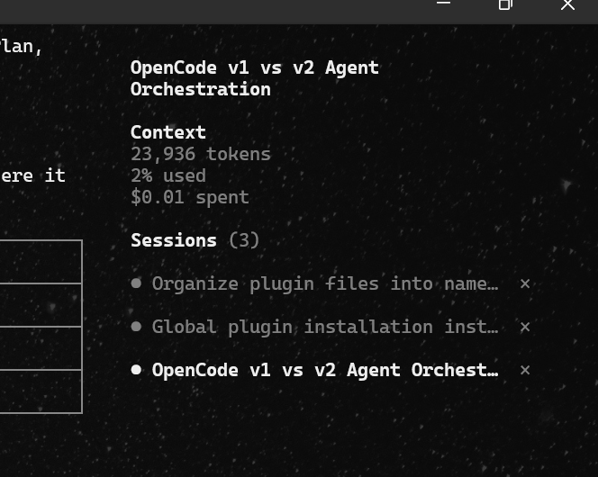

# @leo.gimp/opencode-sessions-sidebar

[OpenCode](https://opencode.ai) v2 TUI plugin that renders open sessions as a **Sessions** block at the bottom of the sidebar - click a row to switch sessions, `×` to close one, or switch with the keyboard (`ctrl+tab` / `ctrl+shift+tab` / `ctrl+1..0`) - and takes over the built-in top tab strip. While the plugin is installed, `tabs.mode` is forced to `"off"` in `cli.json`; uninstalling unmounts the block and releases the setting.

<div align="center">


<br />


<br />

<a href="https://www.buymeacoffee.com/leogimpel"></a>

</div>

## Install

This is a TUI (CLI-only) plugin, so it belongs in **`cli.json`** under the **`plugins`** key - not in `opencode.json(c)`, and not in a `tui.json`. `tui.json` was the OpenCode v1 layout and is not read by v2.

### From npm (recommended)

```bash
opencode plugin add "@leo.gimp/opencode-sessions-sidebar"
```

Or add it by hand to `~/.config/opencode/cli.json`:

```json
{
  "$schema": "https://opencode.ai/v2/cli.json",
  "plugins": ["@leo.gimp/opencode-sessions-sidebar"]
}
```

> [!IMPORTANT]
> The npm package is **scoped to `@leo.gimp`**. The unscoped `opencode-sessions-sidebar` name on npm belongs to a different, unrelated plugin by another author - installing that name gets you their plugin, not this one.

### From source

Point `plugins` at the checkout:

```json
{
  "$schema": "https://opencode.ai/v2/cli.json",
  "plugins": ["C:\\path\\to\\sessions-sidebar"]
}
```

Relative paths (`./plugins/sessions-sidebar`), `file://` URLs, and dropping the folder into `~/.config/opencode/plugins/` all work too. The published tarball ships the TypeScript sources as-is - there is no build step to run.

### Uninstall

```bash
opencode plugin remove "@leo.gimp/opencode-sessions-sidebar"
```

Or delete the entry from `cli.json`. Either way the plugin stops enforcing its settings and the Sessions block is unmounted. Because the plugin forces `tabs.mode: "off"` for as long as it is installed - deliberately not restoring anything while it runs - set **Mode** back (Settings → Tabs → Mode) after uninstalling if you want the built-in strip again.

To turn the plugin off temporarily without uninstalling it, prefix its id with `-` (`opencode plugin list` shows the ids in use):

```json
{
  "$schema": "https://opencode.ai/v2/cli.json",
  "plugins": ["-sessions-sidebar"]
}
```

`cli.json` is watched, so config changes are picked up without restarting OpenCode. Edits to the plugin's own source files are not watched - restart the TUI after changing them.

## Features

<div align="center">



</div>

### Sessions block

A live list of open sessions appended to the bottom of the sidebar content area,
above the built-in footer directory indicator:

- One row per session: **status icon + title**, the active session highlighted in bold
- **Click a row to switch** to that session, click **`×`** to remove it from the list
- A **`+ New session`** row creates a new session and switches to it
- Closing the active session switches to the **most recently opened** session that is still
  open (or home when the list is empty) - the session itself stays in the history, exactly
  like the old tab strip's close
- Deleting a session (from the session manager, another window, or the CLI) **removes its
  row immediately** and switches to the most recently opened session still open; closing
  ("×") and re-opening race-free - a close marks the session so any in-flight registration
  from the same or another window lands as a no-op instead of resurrecting the row
- Tracks up to **10 sessions**, newest at the bottom; the order is append-only, so rows
  never shuffle while you work, and the active session is never evicted by the cap
- The list is **live-synced across every open window** - appends and removals are
  computed against the persisted state under a file lock, so two windows can never
  duplicate or drop each other's rows
- Session titles persist in the plugin's store (kept fresh via rename events), so they
  survive data eviction; untitled sessions render as `New session · 3m`-style labels

### Keyboard

The built-in strip's keymap dies with the strip, so the plugin re-binds the same
keys to its own list (all commands also appear in the palette under **Sessions**):

| Keys | Action |
| --- | --- |
| `ctrl+tab` / `ctrl+shift+tab` | Next / previous session |
| `ctrl+1` … `ctrl+0` | Open session 1 … 10 |
| `<leader>w` | Close the current session |
| `ctrl+shift+t` | Reopen the last closed session |

### Status indicators

Each row's icon mirrors the built-in tab strip logic, across the session and its whole
subagent family - distinct shapes, not just colors, so they stay readable on any
terminal:

- **`!`** - a permission prompt is waiting (warning colour)
- **`?`** - a question form is waiting (warning colour)
- **`●`** - busy: breathing (smooth cosine pulse) while the agent is responding or has
  pending work; static when `animations` is set to `false` in `cli.json` (read once at
  startup)
- **`•`** - unread: the session finished working after you last looked at it
- **`○`** - idle

### Tab strip ownership

While the plugin is **installed**, the built-in top tab strip stays forced off:
it sets `tabs.mode: "off"` in `cli.json` (session tracking moves into the
plugin, because the built-in tab store stops tracking once the strip is
disabled), and it keeps that setting locked for as long as the plugin stays
installed:

- **Forced off all the time** - the value is not temporarily flipped and
  restored on exit; it stays `"off"` across restarts, so Settings always
  shows Tabs → Mode: **off**
- If the setting is changed while the plugin runs - e.g. toggled in the
  settings dialog - the plugin re-asserts `"off"` by watching the config
  file; the TUI re-reads `cli.json` on every file change, so the change snaps
  back within ~150 ms
- Only **uninstalling** the plugin releases the lock - re-enable the strip in
  Settings (Tabs → Mode) at that point
- The plugin writes `mode` and deletes the legacy `enabled` boolean, so the
  two keys can never disagree
- `cli.json` is resolved like OpenCode does (`OPENCODE_CONFIG_DIR`, then
  `XDG_CONFIG_HOME`, then `~/.config/opencode`) and is created when missing;
  writes are atomic (temp + rename). If the file cannot be parsed (e.g. JSONC
  comments), a toast asks you to hide the strip manually

## Notes

- The sidebar row width is fixed by OpenCode's sidebar layout; long titles are
  clipped with a trailing ellipsis, counting terminal display columns so
  CJK/emoji titles cannot overflow the row.
- `index.ts` is a deliberate no-op so the server-side plugin loader resolves the
  package cleanly without pulling TUI-only dependencies into the server module
  map - all rendering lives in `tui.tsx`, which is what the `./tui` export loads.
- `@opencode/plugin`, `@opentui/core`, `@opentui/solid` and `solid-js` are
  declared as real dependencies so the bare specifiers resolve inside
  OpenCode's plugin install cache. The header comment in `tui.tsx` mentions
  `@opentui/solid` only as a `@jsxImportSource` pragma, but the JSX runtime
  must still be importable by name in the installed cache.
- `solid-js` tracks `^1.9.15` - what the OpenCode TUI is built against - rather
  than the exact `1.9.12` that `@opentui/solid` still peers on, which would
  pull a `seroval` with four unfixed critical advisories. npm is strict about
  that stale peer, so the repo ships a `.npmrc` that relaxes it; OpenCode
  installs plugins with Bun, which does not care.

## Requirements

- OpenCode **2.0.0+** (uses the V2 TUI plugin slot API and `cli.json`)

## License

[MIT](LICENSE)
